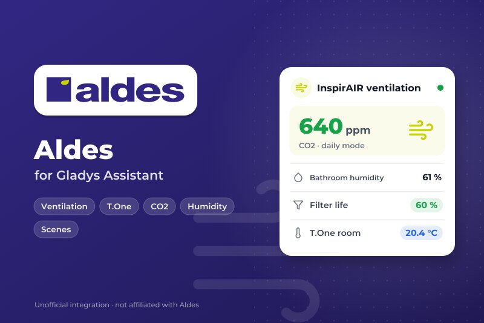
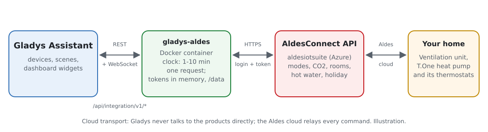
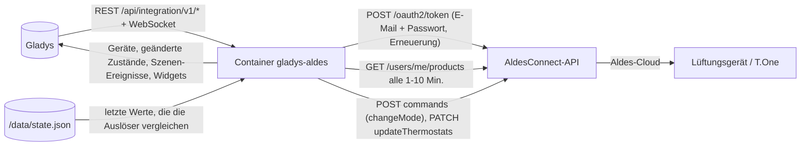
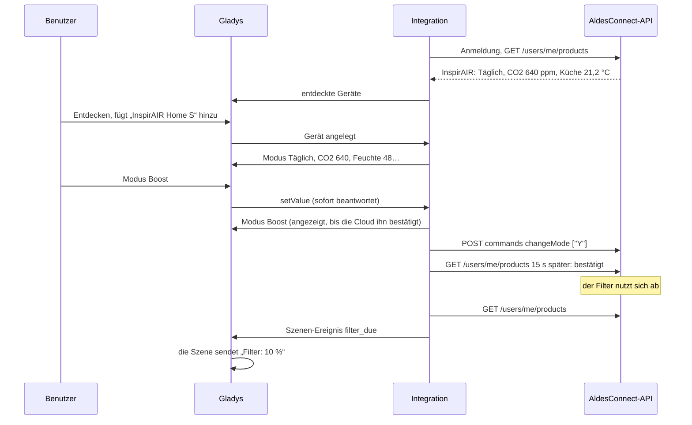
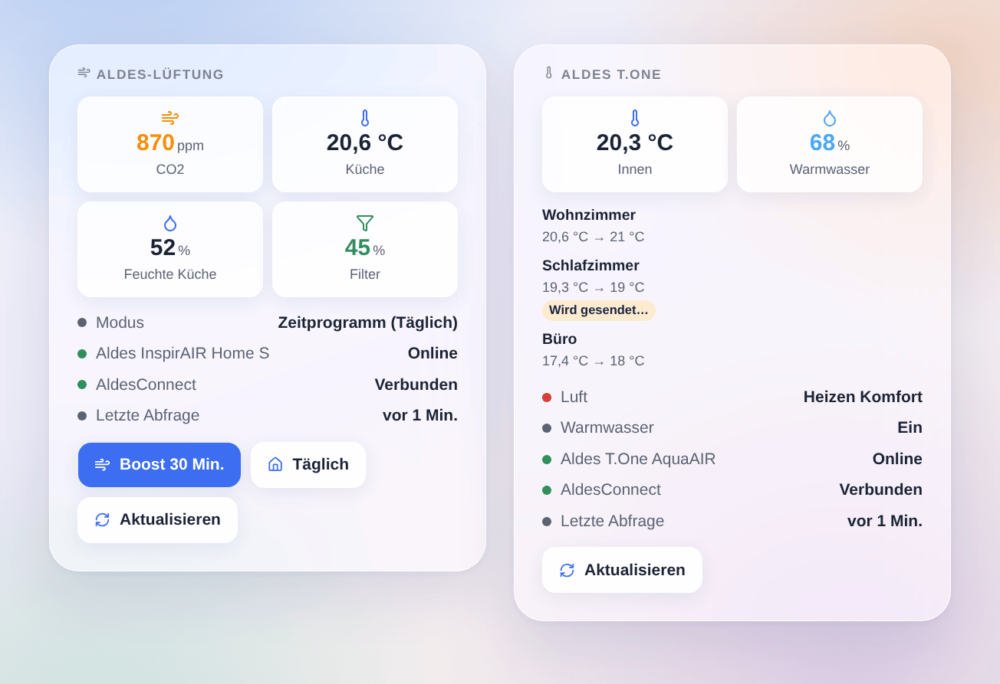

# Gladys Aldes

[English](README.md) · [Français](README.fr.md) · **Deutsch** · [Español](README.es.md)

[](LICENSE)
[](https://github.com/William-De71/gladys-aldes/releases)
[](https://github.com/William-De71/gladys-aldes/actions/workflows/release.yml)
[](https://gladysassistant.com)



Externe Integration für [Gladys Assistant](https://gladysassistant.com) für **Aldes**: die Lüftungsgeräte (InspirAIR, EasyHOME, Dee Fly Cube) mit Modus, CO2, Feuchte und Filter, und die T.One-Wärmepumpen mit Luft- und Warmwassermodus und ihren Raumthermostaten. Sie meldet sich mit Ihrem AldesConnect-Konto an und bringt Szenen-Auslöser (Modus geändert, offline, Filter fällig, Urlaub), Aktionen (Lüftungsmodus, zeitlich begrenzter Boost, Luftmodus, Warmwasser, Urlaub) und zwei Dashboard-Widgets.

Benutzerdokumentation: [English](docs/en.md) · [Français](docs/fr.md) · [Deutsch](docs/de.md) · [Español](docs/es.md).

Keine Verbindung zu Aldes. Aldes veröffentlicht **keine Dokumentation** für den Dienst hinter der AldesConnect-App: Die Anfragen sind dieselben, die die Community-Projekte verwenden ([guix77/homeassistant-aldes](https://github.com/guix77/homeassistant-aldes), [saniho/homeassistant-aldes](https://github.com/saniho/homeassistant-aldes), die Homebridge-Plugins, aldes2mqtt; siehe NOTICE), und sie können sich ohne Vorankündigung ändern. **Noch nicht mit einem echten Aldes-Konto getestet**: Bitte melden Sie, was funktioniert und was nicht.

## Funktionen

- **Ein Gerät pro Lüftungsgerät**: Modus (Täglich, Boost, Gäste, Urlaub, Zeitprogramm) als Liste, CO2 (ppm), Temperatur und Feuchte der Küche und von bis zu fünf Bädern, Filterrestlaufzeit – jeweils, sofern das Gerät den Wert meldet.
- **Ein Gerät pro T.One**: Luftmodus (die neun Modi der App) als Liste, Warmwassermodus und verfügbares Warmwasser bei einer AquaAIR, Haupttemperatur.
- **Ein Thermostat pro Raum einer T.One**: Solltemperatur (ganze Grad, Grenzen des Heiz- oder Kühlmodus), Raumtemperatur, Feuchte, wenn gemessen.
- Alle Produkte mit **einer Anfrage** alle 1, 2, 5 oder 10 Minuten abgefragt. Befehle werden sofort angezeigt und von der nächsten Abfrage bestätigt; ein Produkt, das offline ist, lehnt sie ab.
- Ein **zeitlich begrenzter Boost**, der von selbst zum vorherigen Modus zurückkehrt.
- **4 Szenen-Auslöser**, **6 Szenen-Aktionen** und **2 Dashboard-Widgets** (siehe unten), eine Schaltfläche **Verbindung testen**.
- Überall vier Sprachen: Englisch, Französisch, Deutsch, Spanisch.

## Funktionsweise





Von einem Modus zu einer Szene:



### Transport

`transports: ["cloud"]`: Alle Anfragen gehen mit Ihrem Konto an `aldesiotsuite-aldeswebapi.azurewebsites.net`, den Dienst der AldesConnect-App; die Aldes-Cloud gibt die Befehle an das Produkt weiter. Die App bietet keinen lokalen Zugriff. Passwort und Tokens bleiben im Speicher; `/data` enthält nur die letzten Werte, die die Szenen-Auslöser vergleichen.

## Geräte und Funktionen

| Gerät          | Funktion                    | Kategorie / Typ                                     | Einheit / Werte                                                   | Schreibbar |
| -------------- | --------------------------- | --------------------------------------------------- | ----------------------------------------------------------------- | ---------- |
| Lüftungsgerät  | Lüftungsmodus               | `text` / `select`                                   | Täglich, Boost, Gäste, Urlaub, Zeitprogramm                       | ja         |
| Lüftungsgerät  | CO2                         | `co2-sensor` / `decimal`                            | ppm (mit CO2-Sensor)                                              | nein       |
| Lüftungsgerät  | Temperatur, Feuchte Küche   | `temperature-sensor`, `humidity-sensor` / `decimal` | °C, %                                                             | nein       |
| Lüftungsgerät  | Temperatur, Feuchte Bad 1-5 | `temperature-sensor`, `humidity-sensor` / `decimal` | °C, % (Räume mit Sensor)                                          | nein       |
| Lüftungsgerät  | Filterrestlaufzeit          | `maintenance` / `life-remaining`                    | % (100 − von Aldes gemeldeter Verschleiß)                         | nein       |
| T.One          | Luftmodus                   | `text` / `select`                                   | Aus, Heizen Komfort / Eco / A / B, Kühlen Komfort / Boost / C / D | ja         |
| T.One          | Warmwassermodus             | `water-heater` / `mode`                             | Ein (manuell), Boost, Aus (AquaAIR)                               | ja         |
| T.One          | Verfügbares Warmwasser      | `water-heater` / `remaining-hot-water`              | % (AquaAIR)                                                       | nein       |
| T.One          | Haupttemperatur             | `temperature-sensor` / `decimal`                    | °C                                                                | nein       |
| Raumthermostat | Solltemperatur              | `thermostat` / `target-temperature`                 | °C, 16-31, in Schritten von 1                                     | ja         |
| Raumthermostat | Raumtemperatur, Feuchte     | `temperature-sensor`, `humidity-sensor` / `decimal` | °C, % (wenn gemessen)                                             | nein       |

Die Modi sind Textlisten (`text` / `select`): Gladys hat keinen allgemeinen Wertesatz für die Modi eines Lüftungsgeräts oder der T.One. „Urlaub“ in der Liste gewählt hält den Urlaubsmodus, bis ein anderer Modus gewählt wird (für Aldes ein einjähriger Urlaub). Eine Solltemperatur wird gegen die Grenzen des aktuellen Luftmodus (Heizen oder Kühlen) geprüft, die Aldes angibt. Das Filterfeld ist nicht dokumentiert: Seine Bedeutung stammt aus den Community-Projekten.

## Szenen-Auslöser, Aktionen und Widgets



Widgets:

- **Aldes-Lüftung**: CO2 (nach Stufe eingefärbt), Temperatur und Feuchte der Küche, Filterrestlaufzeit, Modus (und der unter dem Zeitprogramm laufende Modus), Ende eines Boosts, Verbindung, **Boost 30 Min.**, **Täglich** und **Aktualisieren**. Einstellung: das Lüftungsgerät.
- **Aldes T.One**: Haupttemperatur, verfügbares Warmwasser, Räume mit Temperatur und Solltemperatur, Luft- und Warmwassermodus, Urlaub, Verbindung, **Aktualisieren**. Einstellung: die T.One.

Szenen-Auslöser (jeweils nach Produkt filterbar): Der Modus ändert sich (in der App, durch das Zeitprogramm, am Produkt; nie eine von Gladys angeforderte Änderung), ein Produkt geht offline oder wieder online, ein Filter ist fällig (10 % oder weniger), ein Urlaub beginnt oder endet.

Szenen-Aktionen: Lüftungsmodus setzen, die Lüftung N Minuten lang boosten und dann zum vorherigen Modus zurückkehren, T.One-Luftmodus setzen, T.One-Warmwasser einstellen, Aldes-Urlaub setzen (N Tage, 0 zum Aufheben), Aldes jetzt abfragen.

Beispiele:

- Wenn die Feuchte im Bad 75 % übersteigt → die Lüftung 20 Minuten lang boosten.
- Wenn ein Filter fällig ist → benachrichtigen: „Filter: {{triggerEvent.data.filter_life}} %“.
- Wenn ein Produkt offline geht → benachrichtigen und sein WLAN prüfen.

## Voraussetzungen

- Gladys Assistant **5.3.0** oder neuer (ältere Instanzen können sie nicht installieren).
- Ein Aldes-Lüftungsgerät oder eine T.One, in der AldesConnect-App sichtbar, sowie E-Mail-Adresse und Passwort der App.

## Installation

- **Aus dem Store**: Integrationen → Aldes → Installieren.
- **Über die URL des Repositorys**: Integrationen → externe Integration → `https://github.com/William-De71/gladys-aldes`.
- **Entwicklermodus**: `npm start` mit den von Gladys gelieferten Variablen ausführen (siehe Entwicklung).

## Konfiguration

| Feld oder Schaltfläche  | Standard    | Bedeutung                                                                                  |
| ----------------------- | ----------- | ------------------------------------------------------------------------------------------ |
| E-Mail                  | —           | Pflichtfeld, die E-Mail-Adresse des AldesConnect-Kontos                                    |
| Passwort                | —           | Pflichtfeld, geheim: im Speicher gehalten, nie wieder angezeigt, nie protokolliert         |
| Abfrageintervall        | 2 Min.      | 1, 2, 5 oder 10 Minuten; eine Anfrage für alle Produkte                                    |
| Sprache der Gerätetexte | automatisch | Namen der Funktionen und Modi, Meldungen der Schaltfläche                                  |
| Verbindung testen       | —           | Meldet sich sofort an und listet Produkte, Thermostate und nicht unterstützte Produkte auf |

## Verwendung

1. E-Mail und Passwort eingeben, dann auf **Verbindung testen** klicken (Integrationen → Aldes → Konfiguration).
2. **Entdecken**, dann das Lüftungsgerät, die T.One und ihre Raumthermostate hinzufügen.
3. Die Widgets **Aldes-Lüftung** und **Aldes T.One** zu einem Dashboard hinzufügen.
4. Szenen mit den Gerätefunktionen, den Auslösern und den Aktionen bauen.

## Entwicklung

```bash
npm install
npm test                       # node --test, never touches the network
npm run lint                   # ESLint
npm run format:check           # Prettier
npx github:GladysAssistant/integration-store . --skip-image-check
scripts/build-cover.sh         # cover.jpg from docs/assets/cover.svg
docs/illustrations/render.sh   # docs/assets/widgets.<lang>.png
```

Lokal liest das SDK `GLADYS_HOST_API_URL`, `GLADYS_INTEGRATION_TOKEN` und `GLADYS_INTEGRATION_SELECTOR` (von Gladys im Entwicklermodus geliefert), und die Integration liest `TZ` (für die geratene Sprache und die Endzeit eines Boosts). `DEBUG=gladys-integration-sdk` zeigt die Logs des SDK.

Die Tests decken ab: den API-Client (Passwort- und Refresh-Grant, Wiederverwendung des Tokens, abgelehnter Refresh-Token, falsche Zugangsdaten so, wie der echte Dienst sie beantwortet, 401 / 429 / 5xx, nicht erreichbarer Dienst, Abstand zwischen Anfragen, Inhalt der Befehle), das Datenmodell (beide Formen eines Produkts, defensiv gelesene Felder, Modi, Urlaub, Solltemperaturen), die Geräte (die vom Entdecken-Bildschirm verlangten Felder, Kategorie-/Typ-Paare, Textzustände), die Szenen-Auslöser, die Widgets (`validateWidgetContent`), das Manifest, die vier Sprachen, das Release-Skript und die gesamte Integration gegen das Fake-Gladys des SDK und eine Fake-API (befohlene Werte, Produkte offline, zeitlich begrenzter Boost, Ablehnungen, Verlangsamung, Neustart). `test/structure.test.js` friert jeden Schlüssel ein, den Benutzer speichern.

## Release-Prozess


Jeder Merge auf `main` startet die CI und berechnet dann die Version aus den [Conventional Commits](https://www.conventionalcommits.org/) seit dem letzten Tag: `feat` → Minor, `fix` / `perf` → Patch, `!` oder `BREAKING CHANGE` → Major (Minor unter 1.0.0); `docs`, `chore`, `ci`, `test`, `style`, `refactor`, `build` allein veröffentlichen nichts. Der Changelog-Abschnitt wird erzeugt, der Tag gepusht, das Multi-Architektur-Image gebaut, dann erhält `main` den Release-Commit, das GitHub-Release wird angelegt und ein letzter Job prüft das öffentliche Image, den Store-Validator und das Topic.

- Der Titel des Pull-Requests wird zum Squash-Commit und dann zur Changelog-Zeile: Schreiben Sie ihn auf Englisch, für den Benutzer (`pr-title.yml` prüft ihn). Bearbeiten Sie `CHANGELOG.md` nie von Hand.
- 1.0.0 ist eine Entscheidung: Actions → Release → Run workflow mit `release-as: 1.0.0`. `dry-run` zeigt Version und Notizen, ohne zu veröffentlichen.
- **Geschützter Branch**: Rulesets verlangen einen Pull Request auf `main` und sperren die `v*`-Tags; nur der Maintainer und Deploy Keys kommen durch. Das Release pusht mit dem Deploy Key der Umgebung `release` (Secret `RELEASE_DEPLOY_KEY`, nur `main`): Ein Lauf von einem anderen Branch erhält ihn nie. `build.yml` und `github-release.yml` starten nicht bei einem Tag: Das Release ruft sie auf, oder starten Sie sie von Hand (Actions → Run workflow, mit `version` für das Image), um ein Release abzuschließen.
- Machen Sie nach dem ersten Release das Paket auf `ghcr.io` öffentlich (Package settings → Change visibility), sonst kann Gladys es nicht herunterladen.

## Fehlerbehebung

Siehe [docs/de.md](docs/de.md#fehlerbehebung). Melden Sie Probleme mit den Versionen von Gladys und der Integration, dem Modell Ihres Produkts, dem Ergebnis von „Verbindung testen“ und den Logs der Integration. Fügen Sie nie Ihre E-Mail-Adresse oder Ihr Passwort ein.

## Mitwirken

Issues und Pull-Requests sind willkommen. Führen Sie vor dem Öffnen eines Pull-Requests `npm run format:check && npm run lint && npm test` aus und lassen Sie jede externe ID und jeden gespeicherten Schlüssel unverändert (siehe [CLAUDE.md](CLAUDE.md)).

## Sicherheit

Siehe [SECURITY.md](SECURITY.md): Melden Sie Schwachstellen vertraulich. Das Passwort ist ein `secret`-Feld: nie protokolliert, nie in `/data` geschrieben, nur zur Anmeldung per HTTPS an den AldesConnect-Dienst gesendet; die Tokens bleiben im Speicher, und weder sie noch das Passwort erscheinen in einer Fehlermeldung. Aldes bietet keinen getrennten Zugang für Dritte: Die Integration hält das Passwort Ihres Kontos, ändern Sie es also in der AldesConnect-App, um den Zugriff zu widerrufen.

## Kommende Screenshots

Die Bilder oben sind Illustrationen, keine Screenshots. Echte Screenshots kommen nach `docs/assets/screenshots/` (PNG, 1280 × 800): `configuration.png` (Zugangsdaten und „Verbindung testen“), `discovery.png`, `ventilation.png` (das Lüftungsgerät im Dashboard), `scene.png`.

## Lizenz

[Apache License 2.0](LICENSE) – siehe auch [NOTICE](NOTICE). Aldes, AldesConnect, InspirAIR, EasyHOME und T.One sind Marken von Aldes. Die API-Fakten stammen aus den in NOTICE genannten Community-Projekten; es wurde kein Code kopiert. Dank an die Dokumentation und das SDK von Gladys.
