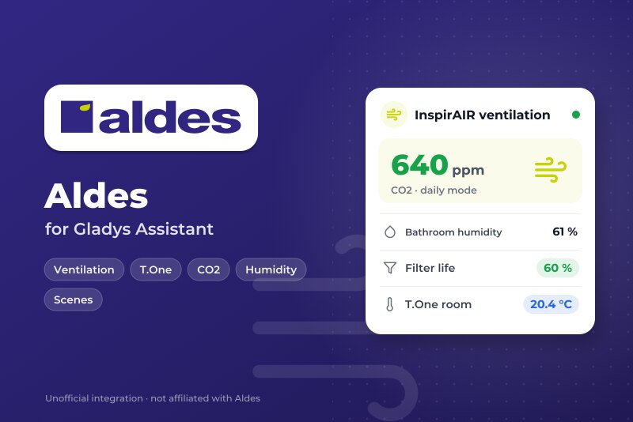
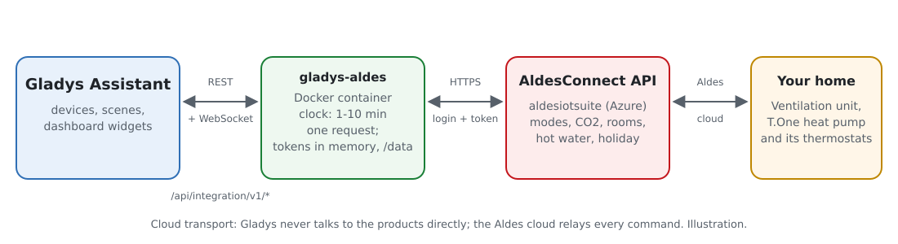
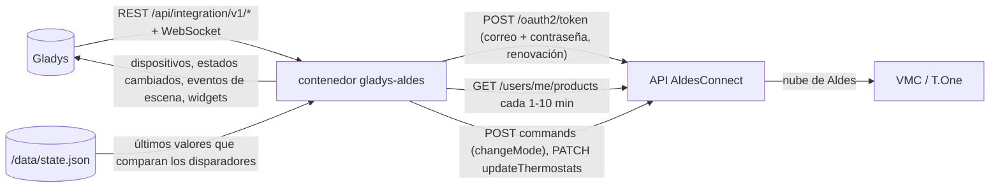
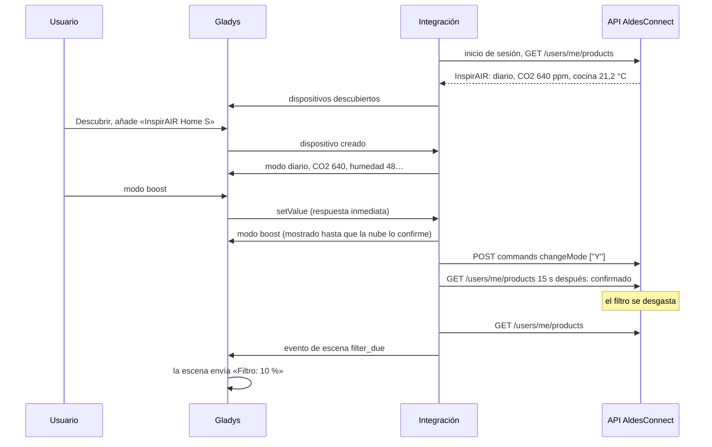

# Gladys Aldes

[English](README.md) · [Français](README.fr.md) · [Deutsch](README.de.md) · **Español**

[](LICENSE)
[](https://github.com/William-De71/gladys-aldes/releases)
[](https://github.com/William-De71/gladys-aldes/actions/workflows/release.yml)
[](https://gladysassistant.com)



Integración externa de [Gladys Assistant](https://gladysassistant.com) para **Aldes**: las VMC (InspirAIR, EasyHOME, Dee Fly Cube) con su modo, su CO2, su humedad y su filtro, y las bombas de calor T.One con sus modos aire y agua caliente y sus termostatos de estancia. Inicia sesión con su cuenta AldesConnect y añade disparadores de escena (modo cambiado, desconexión, filtro por cambiar, vacaciones), acciones (modo de ventilación, boost temporizado, modo aire, agua caliente, vacaciones) y dos widgets para el panel.

Documentación de usuario: [English](docs/en.md) · [Français](docs/fr.md) · [Deutsch](docs/de.md) · [Español](docs/es.md).

Sin relación con Aldes. Aldes **no publica ninguna documentación** del servicio que hay detrás de la app AldesConnect: las peticiones son las que usan los proyectos de la comunidad ([guix77/homeassistant-aldes](https://github.com/guix77/homeassistant-aldes), [saniho/homeassistant-aldes](https://github.com/saniho/homeassistant-aldes), los plugins de Homebridge, aldes2mqtt; ver NOTICE), y pueden cambiar sin previo aviso. **Aún no se ha probado con una cuenta Aldes real**: cuéntenos qué funciona y qué no.

## Funciones

- **Un dispositivo por VMC**: modo (diario, boost, invitados, vacaciones, programación) como lista, CO2 (ppm), temperatura y humedad de la cocina y de hasta cinco baños, vida útil del filtro; cada uno cuando la VMC lo transmite.
- **Un dispositivo por T.One**: modo aire (los nueve modos de la app) como lista, modo agua caliente y agua caliente disponible en una AquaAIR, temperatura principal.
- **Un termostato por estancia de una T.One**: consigna (grados enteros, límites del modo calefacción o refrigeración), temperatura ambiente, humedad si se mide.
- Todos los productos leídos en **una sola petición** cada 1, 2, 5 o 10 minutos. Las órdenes se muestran al instante y las confirma la lectura siguiente; un producto sin conexión las rechaza.
- Un **boost temporizado** que vuelve solo al modo anterior.
- **4 disparadores de escena**, **6 acciones de escena** y **2 widgets** (más abajo), un botón **Probar la conexión**.
- Cuatro idiomas en todas partes: inglés, francés, alemán y español.

## Cómo funciona





De un modo a una escena:



### Transporte

`transports: ["cloud"]`: todas las peticiones van a `aldesiotsuite-aldeswebapi.azurewebsites.net`, el servicio de la app AldesConnect, con su cuenta; la nube de Aldes transmite las órdenes al producto. La app no ofrece ningún acceso local. La contraseña y los tokens se quedan en memoria; `/data` solo guarda los últimos valores que comparan los disparadores de escena.

## Dispositivos y funciones

| Dispositivo            | Función                       | Categoría / tipo                                    | Unidad / valores                                                                  | Escritura |
| ---------------------- | ----------------------------- | --------------------------------------------------- | --------------------------------------------------------------------------------- | --------- |
| VMC                    | Modo de ventilación           | `text` / `select`                                   | diario, boost, invitados, vacaciones, programación                                | sí        |
| VMC                    | CO2                           | `co2-sensor` / `decimal`                            | ppm (con sensor de CO2)                                                           | no        |
| VMC                    | Temperatura, humedad cocina   | `temperature-sensor`, `humidity-sensor` / `decimal` | °C, %                                                                             | no        |
| VMC                    | Temperatura, humedad baño 1-5 | `temperature-sensor`, `humidity-sensor` / `decimal` | °C, % (estancias con sensor)                                                      | no        |
| VMC                    | Vida útil del filtro          | `maintenance` / `life-remaining`                    | % (100 − desgaste transmitido por Aldes)                                          | no        |
| T.One                  | Modo aire                     | `text` / `select`                                   | apagado, calefacción confort / eco / A / B, refrigeración confort / boost / C / D | sí        |
| T.One                  | Modo agua caliente            | `water-heater` / `mode`                             | encendido (manual), boost, apagado (AquaAIR)                                      | sí        |
| T.One                  | Agua caliente disponible      | `water-heater` / `remaining-hot-water`              | % (AquaAIR)                                                                       | no        |
| T.One                  | Temperatura principal         | `temperature-sensor` / `decimal`                    | °C                                                                                | no        |
| Termostato de estancia | Consigna                      | `thermostat` / `target-temperature`                 | °C, 16-31, de 1 en 1                                                              | sí        |
| Termostato de estancia | Temperatura, humedad ambiente | `temperature-sensor`, `humidity-sensor` / `decimal` | °C, % (si se mide)                                                                | no        |

Los modos son listas de texto (`text` / `select`): Gladys no tiene un conjunto de valores genérico para los modos de una VMC ni de la T.One. «Vacaciones» elegido en la lista mantiene el modo vacaciones hasta que se elige otro modo (unas vacaciones de un año para Aldes). Una consigna se comprueba frente a los límites del modo aire actual (calefacción o refrigeración) que indica Aldes. El campo del filtro no está documentado: su significado procede de los proyectos de la comunidad.

## Disparadores, acciones de escena y widgets


Widgets:

- **VMC Aldes**: CO2 (con color según el nivel), temperatura y humedad de la cocina, vida útil del filtro, modo (y el modo en curso bajo la programación), fin de un boost, conexión, **Boost 30 min**, **Diario** y **Actualizar**. Ajustes: la VMC.
- **Aldes T.One**: temperatura principal, agua caliente disponible, estancias con su temperatura y su consigna, modos aire y agua caliente, vacaciones, conexión, **Actualizar**. Ajustes: la T.One.

Disparadores de escena (cada uno filtrado por producto): el modo cambia (en la app, por la programación, en el producto; nunca un cambio pedido por Gladys), un producto se desconecta o se reconecta, hay que cambiar un filtro (10 % o menos), unas vacaciones empiezan o terminan.

Acciones de escena: cambiar el modo de ventilación, activar el boost de la VMC durante N minutos y volver luego al modo anterior, cambiar el modo aire de la T.One, ajustar el agua caliente de la T.One, poner vacaciones Aldes (N días, 0 para anularlas), leer Aldes ahora.

Ejemplos:

- Cuando la humedad del baño supera el 75 % → activar el boost de la VMC durante 20 minutos.
- Cuando hay que cambiar un filtro → notificar «Filtro: {{triggerEvent.data.filter_life}} %».
- Cuando un producto se desconecta → notificar y comprobar su wifi.

## Requisitos

- Gladys Assistant **5.3.0** o posterior (las instancias más antiguas no pueden instalarla).
- Una VMC o una T.One de Aldes visible en la app AldesConnect, y el correo y la contraseña de la app.

## Instalación

- **Desde la tienda**: Integraciones → Aldes → Instalar.
- **Desde la URL del repositorio**: Integraciones → integración externa → `https://github.com/William-De71/gladys-aldes`.
- **Modo desarrollador**: ejecute `npm start` con las variables que da Gladys (ver Desarrollo).

## Configuración

| Campo o botón                            | Por defecto | Significado                                                                         |
| ---------------------------------------- | ----------- | ----------------------------------------------------------------------------------- |
| Correo electrónico                       | —           | Obligatorio, el correo de la cuenta AldesConnect                                    |
| Contraseña                               | —           | Obligatorio, secreto: guardado en memoria, nunca se vuelve a mostrar ni se registra |
| Intervalo de lectura                     | 2 min       | 1, 2, 5 o 10 minutos; una petición para todos los productos                         |
| Idioma de los textos de los dispositivos | automático  | Nombres de las funciones y de los modos, mensajes del botón                         |
| Probar la conexión                       | —           | Inicia sesión al momento y lista los productos, los termostatos y los descartados   |

## Uso

1. Introduzca el correo y la contraseña y pulse **Probar la conexión** (Integraciones → Aldes → Configuración).
2. **Descubrir**, y añada la VMC, la T.One y sus termostatos de estancia.
3. Añada los widgets **VMC Aldes** y **Aldes T.One** a un panel.
4. Cree escenas con las funciones de los dispositivos, los disparadores y las acciones.

## Desarrollo

```bash
npm install
npm test                       # node --test, never touches the network
npm run lint                   # ESLint
npm run format:check           # Prettier
npx github:GladysAssistant/integration-store . --skip-image-check
scripts/build-cover.sh         # cover.jpg from docs/assets/cover.svg
docs/illustrations/render.sh   # docs/assets/widgets.<lang>.png
```

En local, el SDK lee `GLADYS_HOST_API_URL`, `GLADYS_INTEGRATION_TOKEN` y `GLADYS_INTEGRATION_SELECTOR` (que Gladys da en modo desarrollador), y la integración lee `TZ` (para adivinar el idioma y la hora de fin de un boost). `DEBUG=gladys-integration-sdk` muestra los registros del SDK.

Las pruebas cubren el cliente de la API (grants de contraseña y de refresh, reutilización del token, refresh token rechazado, credenciales erróneas tal como responde el servicio real, 401 / 429 / 5xx, servicio inaccesible, espaciado, cuerpo de las órdenes), el modelo de datos (las dos formas de un producto, campos leídos de forma defensiva, modos, vacaciones, consignas), los dispositivos (los campos que exige la pantalla Descubrir, pares categoría / tipo, estados de texto), los disparadores de escena, los widgets (`validateWidgetContent`), el manifiesto, los cuatro idiomas, el script de publicación y toda la integración frente al Gladys simulado del SDK y una API simulada (valores ordenados, productos sin conexión, boost temporizado, rechazos, ralentización, reinicio). `test/structure.test.js` congela cada clave que guardan los usuarios.

## Proceso de publicación


Cada fusión en `main` ejecuta la CI y luego calcula la versión a partir de los [Conventional Commits](https://www.conventionalcommits.org/) desde la última etiqueta: `feat` → minor, `fix` / `perf` → patch, `!` o `BREAKING CHANGE` → major (minor por debajo de 1.0.0); `docs`, `chore`, `ci`, `test`, `style`, `refactor`, `build` por sí solos no publican nada. Se genera la sección del changelog, se sube la etiqueta, se construye la imagen multiarquitectura, luego `main` recibe el commit de la versión, se crea la GitHub Release y un último trabajo comprueba la imagen pública, el validador de la tienda y el topic.

- El título de la pull request se convierte en el commit squash y luego en la línea del changelog: escríbalo en inglés, para el usuario (`pr-title.yml` lo comprueba). No edite nunca `CHANGELOG.md` a mano.
- 1.0.0 es una decisión: Actions → Release → Run workflow con `release-as: 1.0.0`. `dry-run` muestra la versión y las notas sin publicar.
- **Rama protegida**: la publicación sube su commit a `main` con `GITHUB_TOKEN`. El ruleset `protect-main` (sin borrado, sin force-push) lo deja pasar; una regla más estricta (pull request o comprobaciones obligatorias) necesitaría GitHub Actions en su lista de excepciones, o una GitHub App.
- Tras la primera publicación, haga público el paquete de `ghcr.io` (Package settings → Change visibility); si no, Gladys no puede descargarlo.

## Solución de problemas

Ver [docs/es.md](docs/es.md#solución-de-problemas). Informe de los problemas con las versiones de Gladys y de la integración, el modelo de su producto, el resultado de «Probar la conexión» y los registros de la integración. No pegue nunca su correo ni su contraseña.

## Contribuir

Las issues y las pull requests son bienvenidas. Ejecute `npm run format:check && npm run lint && npm test` antes de abrir una pull request, y no cambie ningún id externo ni ninguna clave guardada (ver [CLAUDE.md](CLAUDE.md)).

## Seguridad

Ver [SECURITY.md](SECURITY.md): informe de las vulnerabilidades en privado. La contraseña es un campo `secret`: nunca se registra, nunca se escribe en `/data` y solo se envía al servicio AldesConnect por HTTPS para iniciar sesión; los tokens se quedan en memoria y ni ellos ni la contraseña aparecen en un mensaje de error. Aldes no ofrece un acceso separado para terceros: la integración guarda la contraseña de su cuenta, así que cámbiela en la app AldesConnect para revocar el acceso.

## Capturas por venir

Las imágenes de arriba son ilustraciones, no capturas de pantalla. Las capturas reales irán en `docs/assets/screenshots/` (PNG, 1280 × 800): `configuration.png` (credenciales y «Probar la conexión»), `discovery.png`, `ventilation.png` (la VMC en el panel), `scene.png`.

## Licencia

[Apache License 2.0](LICENSE) — ver también [NOTICE](NOTICE). Aldes, AldesConnect, InspirAIR, EasyHOME y T.One son marcas de Aldes. Los datos de la API proceden de los proyectos de la comunidad citados en NOTICE; no se ha copiado código. Gracias a la documentación y al SDK de Gladys.
