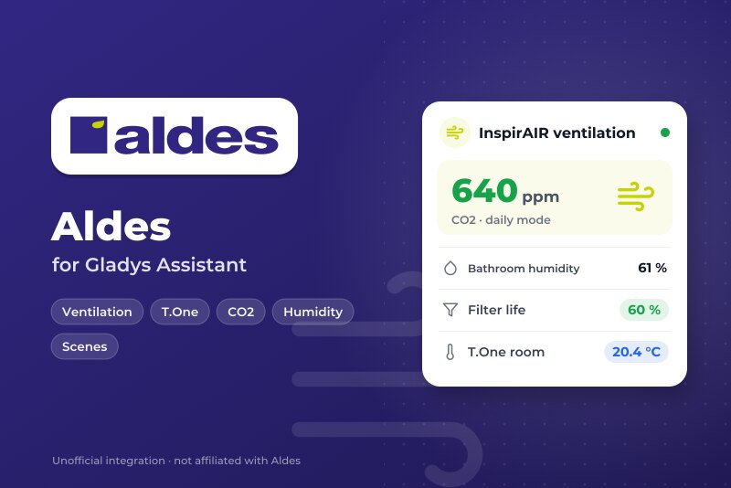
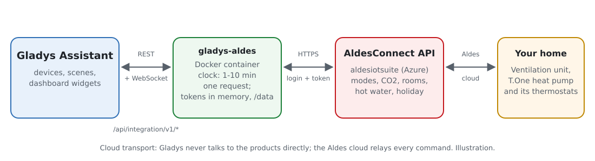
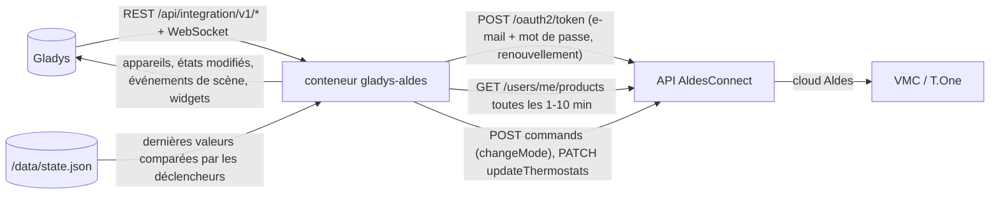
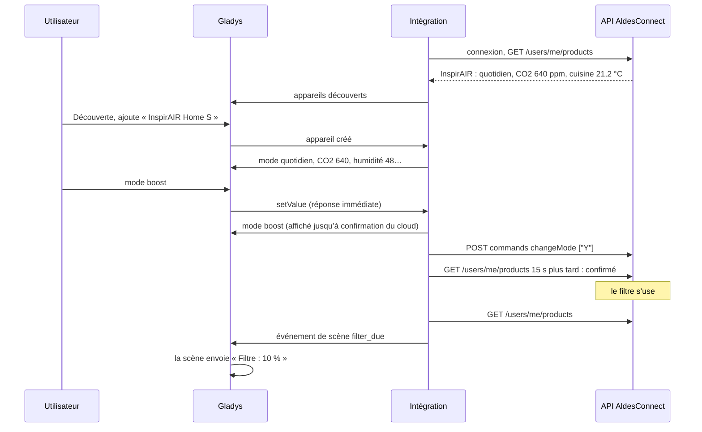

# Gladys Aldes

[English](README.md) · **Français** · [Deutsch](README.de.md) · [Español](README.es.md)

[](LICENSE)
[](https://github.com/William-De71/gladys-aldes/releases)
[](https://github.com/William-De71/gladys-aldes/actions/workflows/release.yml)
[](https://gladysassistant.com)



Intégration externe [Gladys Assistant](https://gladysassistant.com) pour **Aldes** : les VMC (InspirAIR, EasyHOME, Dee Fly Cube) avec leur mode, le CO2, l’humidité et le filtre, et les pompes à chaleur T.One avec leurs modes air et eau chaude et leurs thermostats de pièce. Elle se connecte avec votre compte AldesConnect, ajoute des déclencheurs de scène (mode changé, hors ligne, filtre à changer, vacances) et des actions (mode de ventilation, boost minuté, mode air, eau chaude, vacances), et deux widgets de tableau de bord.

Documentation utilisateur : [English](docs/en.md) · [Français](docs/fr.md) · [Deutsch](docs/de.md) · [Español](docs/es.md).

Sans lien avec Aldes. Aldes ne publie **aucune documentation** du service de l’application AldesConnect : les requêtes sont celles qu’utilisent les projets de la communauté ([guix77/homeassistant-aldes](https://github.com/guix77/homeassistant-aldes), [saniho/homeassistant-aldes](https://github.com/saniho/homeassistant-aldes), les plugins Homebridge, aldes2mqtt ; voir NOTICE), et elles peuvent changer sans préavis. **Pas encore testée avec un vrai compte Aldes** : dites-nous ce qui marche et ce qui ne marche pas.

## Fonctionnalités

- **Un appareil par VMC** : mode (quotidien, boost, invités, vacances, programmation) sous forme de liste, CO2 (ppm), température et humidité de la cuisine et de cinq salles de bain au plus, durée de vie du filtre — chacun quand la VMC le transmet.
- **Un appareil par T.One** : mode air (les neuf modes de l’application) sous forme de liste, mode eau chaude et eau chaude disponible sur une AquaAIR, température principale.
- **Un thermostat par pièce d’une T.One** : consigne (au degré près, dans les limites du mode chauffage ou rafraîchissement), température de la pièce, humidité si elle est mesurée.
- Tous les produits relevés en **une seule requête** toutes les 1, 2, 5 ou 10 minutes. Commandes affichées tout de suite et confirmées au relevé suivant ; un produit hors ligne les refuse.
- Un **boost minuté** qui revient de lui-même au mode précédent.
- **4 déclencheurs de scène**, **6 actions de scène** et **2 widgets** (ci-dessous), un bouton **Tester la connexion**.
- Quatre langues partout : anglais, français, allemand, espagnol.

## Fonctionnement





D’un mode à une scène :



### Transport

`transports: ["cloud"]` : toutes les requêtes vont à `aldesiotsuite-aldeswebapi.azurewebsites.net`, le service de l’application AldesConnect, avec votre compte ; le cloud Aldes transmet les commandes au produit. L’application ne propose aucun accès local. Le mot de passe et les jetons restent en mémoire ; `/data` ne garde que les dernières valeurs comparées par les déclencheurs de scène.

## Appareils et fonctionnalités

| Appareil            | Fonctionnalité                          | Catégorie / type                                    | Unité / valeurs                                                                  | Modifiable |
| ------------------- | --------------------------------------- | --------------------------------------------------- | -------------------------------------------------------------------------------- | ---------- |
| VMC                 | Mode de ventilation                     | `text` / `select`                                   | quotidien, boost, invités, vacances, programmation                               | oui        |
| VMC                 | CO2                                     | `co2-sensor` / `decimal`                            | ppm (avec une sonde CO2)                                                         | non        |
| VMC                 | Température, humidité cuisine           | `temperature-sensor`, `humidity-sensor` / `decimal` | °C, %                                                                            | non        |
| VMC                 | Température, humidité salle de bain 1-5 | `temperature-sensor`, `humidity-sensor` / `decimal` | °C, % (pièces avec sonde)                                                        | non        |
| VMC                 | Durée de vie du filtre                  | `maintenance` / `life-remaining`                    | % (100 − usure transmise par Aldes)                                              | non        |
| T.One               | Mode air                                | `text` / `select`                                   | arrêt, chauffage confort / éco / A / B, rafraîchissement confort / boost / C / D | oui        |
| T.One               | Mode eau chaude                         | `water-heater` / `mode`                             | marche (manuel), boost, arrêt (AquaAIR)                                          | oui        |
| T.One               | Eau chaude disponible                   | `water-heater` / `remaining-hot-water`              | % (AquaAIR)                                                                      | non        |
| T.One               | Température principale                  | `temperature-sensor` / `decimal`                    | °C                                                                               | non        |
| Thermostat de pièce | Consigne                                | `thermostat` / `target-temperature`                 | °C, 16-31, par 1                                                                 | oui        |
| Thermostat de pièce | Température, humidité de la pièce       | `temperature-sensor`, `humidity-sensor` / `decimal` | °C, % (si mesurée)                                                               | non        |

Les modes sont des listes de texte (`text` / `select`) : Gladys n’a pas de jeu de valeurs générique pour les modes d’une VMC ou de la T.One. « Vacances » choisi dans la liste garde le mode vacances jusqu’au choix d’un autre mode (des vacances d’un an pour Aldes). Une consigne est vérifiée par rapport aux limites du mode air en cours (chauffage ou rafraîchissement) données par Aldes. Le champ du filtre n’est pas documenté : son sens vient des projets de la communauté.

## Déclencheurs, actions de scène et widgets


Widgets :

- **VMC Aldes** : CO2 (coloré selon le niveau), température et humidité de la cuisine, durée de vie du filtre, mode (et mode en cours sous la programmation), fin d’un boost, connexion, **Boost 30 min**, **Quotidien** et **Actualiser**. Réglage : la VMC.
- **Aldes T.One** : température principale, eau chaude disponible, pièces avec leur température et leur consigne, modes air et eau chaude, vacances, connexion, **Actualiser**. Réglage : la T.One.

Déclencheurs de scène (chacun filtré par produit) : le mode change (dans l’application, par la programmation, sur le produit ; jamais un changement demandé par Gladys), un produit se déconnecte ou se reconnecte, un filtre est à changer (10 % ou moins), des vacances commencent ou finissent.

Actions de scène : changer le mode de la VMC, booster la VMC N minutes puis revenir au mode précédent, changer le mode air de la T.One, régler l’eau chaude de la T.One, poser des vacances Aldes (N jours, 0 pour annuler), relever Aldes maintenant.

Exemples :

- Quand l’humidité de la salle de bain dépasse 75 % → booster la VMC 20 minutes.
- Quand un filtre est à changer → notifier « Filtre : {{triggerEvent.data.filter_life}} % ».
- Quand un produit se déconnecte → notifier, et vérifier son Wi-Fi.

## Prérequis

- Gladys Assistant **5.3.0** ou plus récent (les instances plus anciennes ne peuvent pas l’installer).
- Une VMC ou une T.One Aldes visible dans l’application AldesConnect, et l’e-mail et le mot de passe de l’application.

## Installation

- **Depuis le store** : Intégrations → Aldes → Installer.
- **Depuis l’URL du dépôt** : Intégrations → intégration externe → `https://github.com/William-De71/gladys-aldes`.
- **Mode développeur** : lancez `npm start` avec les variables données par Gladys (voir Développement).

## Configuration

| Champ ou bouton                 | Défaut      | Rôle                                                                     |
| ------------------------------- | ----------- | ------------------------------------------------------------------------ |
| E-mail                          | —           | Obligatoire, l’e-mail du compte AldesConnect                             |
| Mot de passe                    | —           | Obligatoire, secret : gardé en mémoire, jamais réaffiché ni journalisé   |
| Intervalle de relevé            | 2 min       | 1, 2, 5 ou 10 minutes ; une requête pour tous les produits               |
| Langue des textes des appareils | automatique | Noms des fonctionnalités et des modes, messages du bouton                |
| Tester la connexion             | —           | Se connecte et liste les produits, les thermostats, ceux laissés de côté |

## Utilisation

1. Saisissez l’e-mail et le mot de passe, puis appuyez sur **Tester la connexion** (Intégrations → Aldes → Configuration).
2. **Découverte**, puis ajoutez la VMC, la T.One et ses thermostats de pièce.
3. Ajoutez les widgets **VMC Aldes** et **Aldes T.One** à un tableau de bord.
4. Construisez des scènes avec les fonctionnalités des appareils, les déclencheurs et les actions.

## Développement

```bash
npm install
npm test                       # node --test, ne touche jamais le réseau
npm run lint                   # ESLint
npm run format:check           # Prettier
npx github:GladysAssistant/integration-store . --skip-image-check
scripts/build-cover.sh         # cover.jpg depuis docs/assets/cover.svg
docs/illustrations/render.sh   # docs/assets/widgets.<lang>.png
```

En local, le SDK lit `GLADYS_HOST_API_URL`, `GLADYS_INTEGRATION_TOKEN` et `GLADYS_INTEGRATION_SELECTOR` (donnés par Gladys en mode développeur), et l’intégration lit `TZ` (la langue devinée, l’heure de fin d’un boost). `DEBUG=gladys-integration-sdk` affiche les journaux du SDK.

Les tests couvrent le client de l’API (connexion par mot de passe et par jeton de renouvellement, réutilisation du jeton, jeton de renouvellement refusé, mauvais identifiants tels que le vrai service les refuse, 401 / 429 / 5xx, service injoignable, espacement, corps des commandes), le modèle de données (les deux formes d’un produit, champs lus prudemment, modes, vacances, consignes), les appareils (champs exigés par l’écran Découverte, couples catégorie / type, états texte), les déclencheurs, les widgets (`validateWidgetContent`), le manifeste, les quatre langues, le script de release, et toute l’intégration face au faux Gladys du SDK et à une fausse API (valeurs commandées, produits hors ligne, boost minuté, refus, ralentissement, redémarrage). `test/structure.test.js` fige chaque clé que les utilisateurs enregistrent.

## Processus de release


Chaque fusion sur `main` lance la CI, puis calcule la version à partir des [Conventional Commits](https://www.conventionalcommits.org/) depuis le dernier tag : `feat` → mineure, `fix` / `perf` → correctif, `!` ou `BREAKING CHANGE` → majeure (une mineure sous 1.0.0) ; `docs`, `chore`, `ci`, `test`, `style`, `refactor`, `build` seuls ne publient rien. La section du changelog est générée, le tag poussé, l’image multi-architecture construite, puis `main` reçoit le commit de release, la GitHub Release est créée et un dernier job vérifie l’image publique, le validateur du store et le topic.

- Le titre de la pull request devient le commit squash, puis la ligne du changelog : écrivez-le en anglais, pour l’utilisateur (`pr-title.yml` le vérifie). Ne modifiez jamais `CHANGELOG.md` à la main.
- La 1.0.0 est une décision : Actions → Release → Run workflow avec `release-as: 1.0.0`. `dry-run` montre la version et les notes sans rien publier.
- **Branche protégée** : la release pousse son commit sur `main` avec `GITHUB_TOKEN`. Le ruleset `protect-main` (ni suppression, ni force-push) le laisse passer ; une règle plus stricte (pull request obligatoire, status checks) demanderait GitHub Actions dans la liste de contournement, ou une GitHub App.
- Après la première release, rendez public le package `ghcr.io` (Package settings → Change visibility), sinon Gladys ne peut pas le télécharger.

## Dépannage

Voir [docs/fr.md](docs/fr.md#dépannage). Signalez les problèmes avec les versions de Gladys et de l’intégration, le modèle de votre produit, le résultat de « Tester la connexion » et les journaux de l’intégration. Ne collez jamais votre e-mail ni votre mot de passe.

## Contribuer

Issues et pull requests bienvenues. Lancez `npm run format:check && npm run lint && npm test` avant d’ouvrir une pull request, et ne changez aucun identifiant externe ni aucune clé enregistrée (voir [CLAUDE.md](CLAUDE.md)).

## Sécurité

Voir [SECURITY.md](SECURITY.md) : signalez les failles en privé. Le mot de passe est un champ `secret` : jamais journalisé, jamais écrit dans `/data`, envoyé seulement au service AldesConnect en HTTPS pour se connecter ; les jetons restent en mémoire et ni eux ni le mot de passe n’apparaissent dans un message d’erreur. Aldes ne propose pas d’accès séparé pour les tiers : l’intégration détient le mot de passe de votre compte ; changez-le dans l’application AldesConnect pour lui retirer l’accès.

## Captures à venir

Les images ci-dessus sont des illustrations, pas des captures d’écran. Les vraies captures iront dans `docs/assets/screenshots/` (PNG, 1280 × 800) : `configuration.png` (identifiants et « Tester la connexion »), `discovery.png`, `ventilation.png` (la VMC sur le tableau de bord), `scene.png`.

## Licence

[Licence Apache 2.0](LICENSE) — voir aussi [NOTICE](NOTICE). Aldes, AldesConnect, InspirAIR, EasyHOME et T.One sont des marques d’Aldes. Les faits sur l’API viennent des projets de la communauté cités dans NOTICE ; aucun code n’a été copié. Merci à la documentation et au SDK de Gladys.
