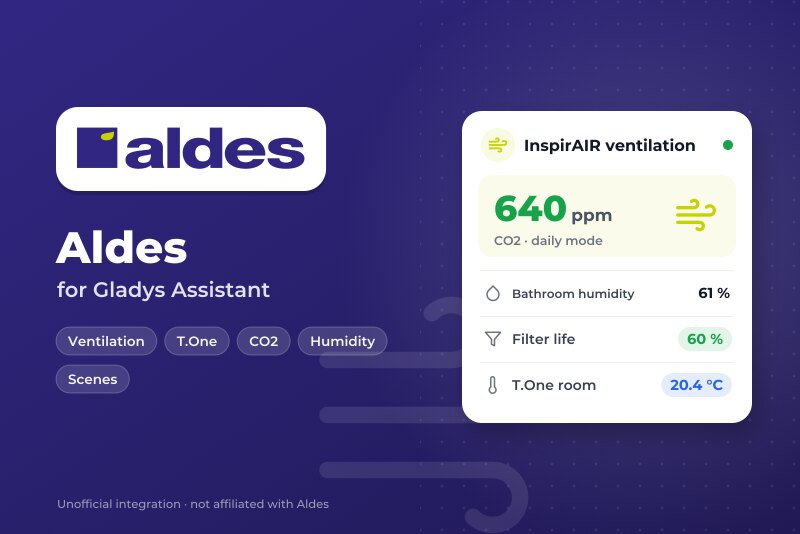
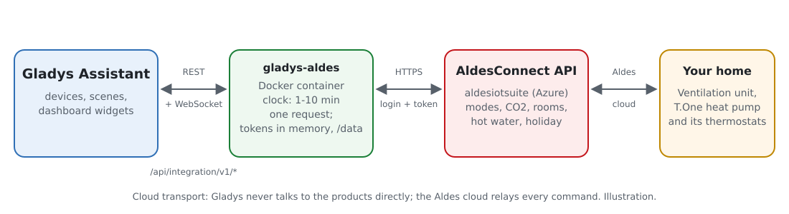
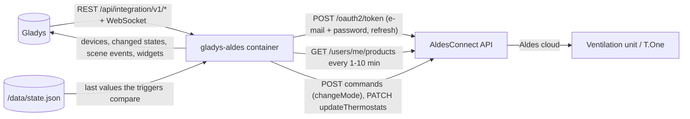
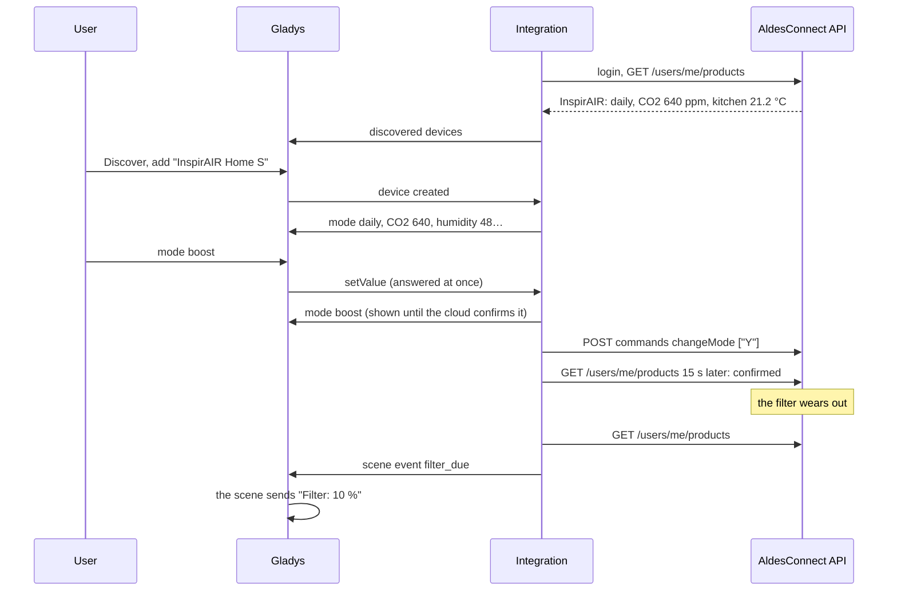

# Gladys Aldes

**English** · [Français](README.fr.md) · [Deutsch](README.de.md) · [Español](README.es.md)

[](LICENSE)
[](https://github.com/William-De71/gladys-aldes/releases)
[](https://github.com/William-De71/gladys-aldes/actions/workflows/release.yml)
[](https://gladysassistant.com)



[Gladys Assistant](https://gladysassistant.com) external integration for **Aldes**: the ventilation units (InspirAIR, EasyHOME, Dee Fly Cube) with their mode, CO2, humidity and filter, and the T.One heat pumps with their air and hot water modes and their room thermostats. It signs in with your AldesConnect account, adds scene triggers (mode changed, offline, filter due, holiday) and actions (ventilation mode, timed boost, air mode, hot water, holiday), and two dashboard widgets.

User documentation: [English](docs/en.md) · [Français](docs/fr.md) · [Deutsch](docs/de.md) · [Español](docs/es.md).

Not affiliated with Aldes. Aldes publishes **no documentation** for the service behind the AldesConnect app: the requests are the ones the community projects use ([guix77/homeassistant-aldes](https://github.com/guix77/homeassistant-aldes), [saniho/homeassistant-aldes](https://github.com/saniho/homeassistant-aldes), the Homebridge plugins, aldes2mqtt; see NOTICE), and they may change without notice. **Not tested with a real Aldes account yet**: please report what works and what does not.

## Features

- **One device per ventilation unit**: mode (daily, boost, guests, holidays, schedule) as a list, CO2 (ppm), temperature and humidity of the kitchen and of up to five bathrooms, filter life — each one when the unit reports it.
- **One device per T.One**: air mode (the nine modes of the app) as a list, hot water mode and hot water available on an AquaAIR, main temperature.
- **One thermostat per room of a T.One**: setpoint (whole degrees, bounds of the heating or cooling mode), room temperature, humidity when measured.
- Every product read in **one request** every 1, 2, 5 or 10 minutes. Commands shown at once and confirmed by the next reading; an offline product refuses them.
- A **timed boost** that goes back to the previous mode by itself.
- **4 scene triggers**, **6 scene actions** and **2 dashboard widgets** (below), a **Test the connection** button.
- Four languages everywhere: English, French, German, Spanish.

## How it works





From a mode to a scene:



### Transport

`transports: ["cloud"]`: every request goes to `aldesiotsuite-aldeswebapi.azurewebsites.net`, the service of the AldesConnect app, with your account; the Aldes cloud relays the commands to the product. The app offers no local access. The password and the tokens stay in memory; `/data` only keeps the last values the scene triggers compare.

## Devices and features

| Device           | Feature                            | Category / type                                     | Unit / values                                                       | Writable |
| ---------------- | ---------------------------------- | --------------------------------------------------- | ------------------------------------------------------------------- | -------- |
| Ventilation unit | Ventilation mode                   | `text` / `select`                                   | daily, boost, guests, holidays, schedule                            | yes      |
| Ventilation unit | CO2                                | `co2-sensor` / `decimal`                            | ppm (with a CO2 sensor)                                             | no       |
| Ventilation unit | Kitchen temperature, humidity      | `temperature-sensor`, `humidity-sensor` / `decimal` | °C, %                                                               | no       |
| Ventilation unit | Bathroom 1-5 temperature, humidity | `temperature-sensor`, `humidity-sensor` / `decimal` | °C, % (rooms with a sensor)                                         | no       |
| Ventilation unit | Filter life                        | `maintenance` / `life-remaining`                    | % (100 − wear reported by Aldes)                                    | no       |
| T.One            | Air mode                           | `text` / `select`                                   | off, heating comfort / eco / A / B, cooling comfort / boost / C / D | yes      |
| T.One            | Hot water mode                     | `water-heater` / `mode`                             | on (manual), boost, off (AquaAIR)                                   | yes      |
| T.One            | Hot water available                | `water-heater` / `remaining-hot-water`              | % (AquaAIR)                                                         | no       |
| T.One            | Main temperature                   | `temperature-sensor` / `decimal`                    | °C                                                                  | no       |
| Room thermostat  | Setpoint                           | `thermostat` / `target-temperature`                 | °C, 16-31, by 1                                                     | yes      |
| Room thermostat  | Room temperature, humidity         | `temperature-sensor`, `humidity-sensor` / `decimal` | °C, % (when measured)                                               | no       |

The modes are text lists (`text` / `select`): Gladys has no generic value set for the modes of a ventilation unit or of the T.One. "Holidays" chosen in the list keeps the holiday mode until another mode is chosen (a one-year holiday for Aldes). A setpoint is checked against the bounds of the current air mode (heating or cooling) that Aldes gives. The filter field is not documented: its meaning comes from the community projects.

## Scene triggers, actions and widgets


Widgets:

- **Aldes ventilation**: CO2 (colored by level), kitchen temperature and humidity, filter life, mode (and the mode running under the schedule), end of a boost, connection, **Boost 30 min**, **Daily** and **Refresh**. Settings: the ventilation unit.
- **Aldes T.One**: main temperature, hot water available, rooms with their temperature and setpoint, air and hot water modes, holiday, connection, **Refresh**. Settings: the T.One.

Scene triggers (each one filtered by product): the mode changes (in the app, by the schedule, on the product; never a change Gladys asked for), a product goes offline or back online, a filter is due (10 % or less), a holiday starts or ends.

Scene actions: set the ventilation mode, boost the ventilation for N minutes then go back to the previous mode, set the T.One air mode, set the T.One hot water, set an Aldes holiday (N days, 0 to cancel), read Aldes now.

Examples:

- When the bathroom humidity goes above 75 % → boost the ventilation for 20 minutes.
- When a filter is due → notify "Filter: {{triggerEvent.data.filter_life}} %".
- When a product goes offline → notify, and check its Wi-Fi.

## Requirements

- Gladys Assistant **5.3.0** or later (older instances cannot install it).
- An Aldes ventilation unit or T.One shown in the AldesConnect app, and the e-mail and password of the app.

## Installation

- **From the store**: Integrations → Aldes → Install.
- **From the repository URL**: Integrations → external integration → `https://github.com/William-De71/gladys-aldes`.
- **Developer mode**: run `npm start` with the variables given by Gladys (see Development).

## Configuration

| Field or button              | Default   | Meaning                                                                 |
| ---------------------------- | --------- | ----------------------------------------------------------------------- |
| E-mail                       | —         | Required, the e-mail of the AldesConnect account                        |
| Password                     | —         | Required, a secret: kept in memory, never shown again, never logged     |
| Reading interval             | 2 min     | 1, 2, 5 or 10 minutes; one request for every product                    |
| Language of the device texts | automatic | Feature and mode names, button messages                                 |
| Test the connection          | —         | Signs in now and lists the products, the thermostats, the ones left out |

## Usage

1. Enter the e-mail and the password, then press **Test the connection** (Integrations → Aldes → Configuration).
2. **Discover**, then add the ventilation unit, the T.One and its room thermostats.
3. Add the **Aldes ventilation** and **Aldes T.One** widgets to a dashboard.
4. Build scenes with the device features, the triggers and the actions.

## Development

```bash
npm install
npm test                       # node --test, never touches the network
npm run lint                   # ESLint
npm run format:check           # Prettier
npx github:GladysAssistant/integration-store . --skip-image-check
scripts/build-cover.sh         # cover.jpg from docs/assets/cover.svg
docs/illustrations/render.sh   # docs/assets/widgets.<lang>.png
```

Locally, the SDK reads `GLADYS_HOST_API_URL`, `GLADYS_INTEGRATION_TOKEN` and `GLADYS_INTEGRATION_SELECTOR` (given by Gladys in developer mode), and the integration reads `TZ` (the language guess, the end time of a boost). `DEBUG=gladys-integration-sdk` shows the SDK logs.

The tests cover the API client (password and refresh grants, token reuse, a refused refresh token, wrong credentials as the real service answers them, 401 / 429 / 5xx, unreachable service, spacing, the bodies of the commands), the data model (both shapes of a product, fields read defensively, modes, holidays, setpoints), the devices (the fields the Discovery screen requires, category / type pairs, text states), the scene triggers, the widgets (`validateWidgetContent`), the manifest, the four languages, the release script, and the whole integration against the fake Gladys of the SDK and a fake API (commanded values, offline products, timed boost, refusals, slow-down, restart). `test/structure.test.js` freezes every key users store.

## Release process


Every merge on `main` runs the CI, then computes the version from the [Conventional Commits](https://www.conventionalcommits.org/) since the last tag: `feat` → minor, `fix` / `perf` → patch, `!` or `BREAKING CHANGE` → major (a minor below 1.0.0); `docs`, `chore`, `ci`, `test`, `style`, `refactor`, `build` alone publish nothing. The changelog section is generated, the tag pushed, the multi-architecture image built, then `main` receives the release commit, the GitHub Release is created and a last job checks the public image, the store validator and the topic.

- The pull request title becomes the squash commit, then the changelog line: write it in English, for the user (`pr-title.yml` checks it). Never edit `CHANGELOG.md` by hand.
- 1.0.0 is a decision: Actions → Release → Run workflow with `release-as: 1.0.0`. `dry-run` shows the version and the notes without publishing.
- **Protected branch**: rulesets require a pull request on `main` and lock the `v*` tags; only the maintainer and deploy keys get through. The release pushes with the deploy key of the `release` environment (secret `RELEASE_DEPLOY_KEY`, `main` only): a run from another branch never gets it. `build.yml` and `github-release.yml` do not start on a tag: the release calls them, or run them by hand (Actions → Run workflow, with `version` for the image) to finish a release.
- After the first release, make the `ghcr.io` package public (Package settings → Change visibility), or Gladys cannot pull it.

## Troubleshooting

See [docs/en.md](docs/en.md#troubleshooting). Report issues with the versions of Gladys and of the integration, the model of your product, the result of "Test the connection" and the logs of the integration. Never paste your e-mail nor your password.

## Contributing

Issues and pull requests are welcome. Run `npm run format:check && npm run lint && npm test` before opening a pull request, and keep every external id and stored key unchanged (see [CLAUDE.md](CLAUDE.md)).

## Security

See [SECURITY.md](SECURITY.md): report vulnerabilities privately. The password is a `secret` field: never logged, never written to `/data`, sent only to the AldesConnect service over HTTPS to sign in; the tokens stay in memory and neither they nor the password appear in an error message. Aldes offers no separate access for third parties: the integration holds the password of your account, so change it in the AldesConnect app to revoke the access.

## Screenshots to come

The images above are illustrations, not screenshots. Real screenshots will go in `docs/assets/screenshots/` (PNG, 1280 × 800): `configuration.png` (credentials and "Test the connection"), `discovery.png`, `ventilation.png` (the unit on the dashboard), `scene.png`.

## License

[Apache License 2.0](LICENSE) — see also [NOTICE](NOTICE). Aldes, AldesConnect, InspirAIR, EasyHOME and T.One are trademarks of Aldes. The API facts come from the community projects credited in NOTICE; no code was copied. Thanks to the Gladys documentation and SDK.
